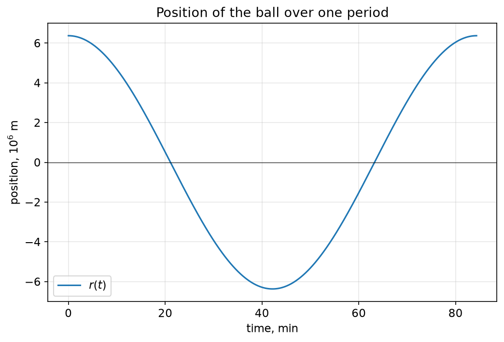
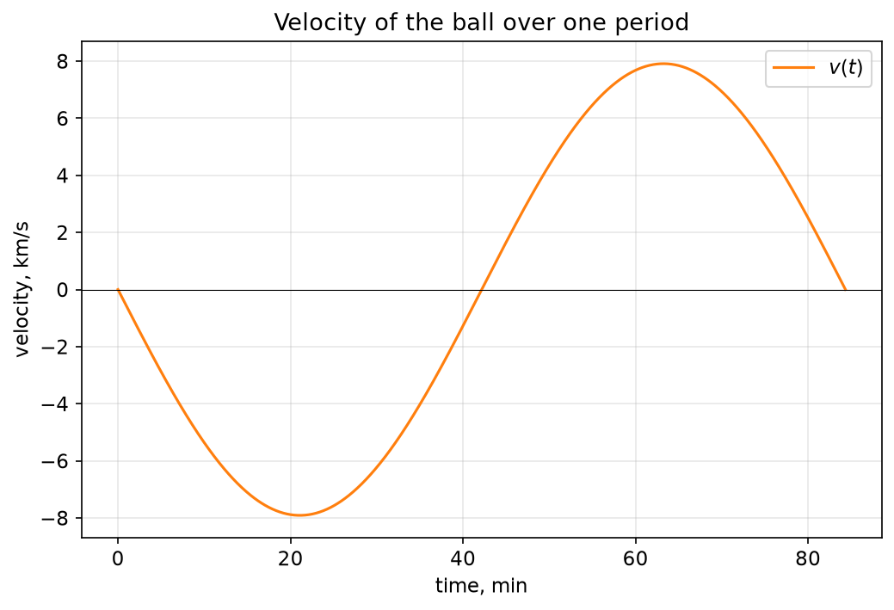
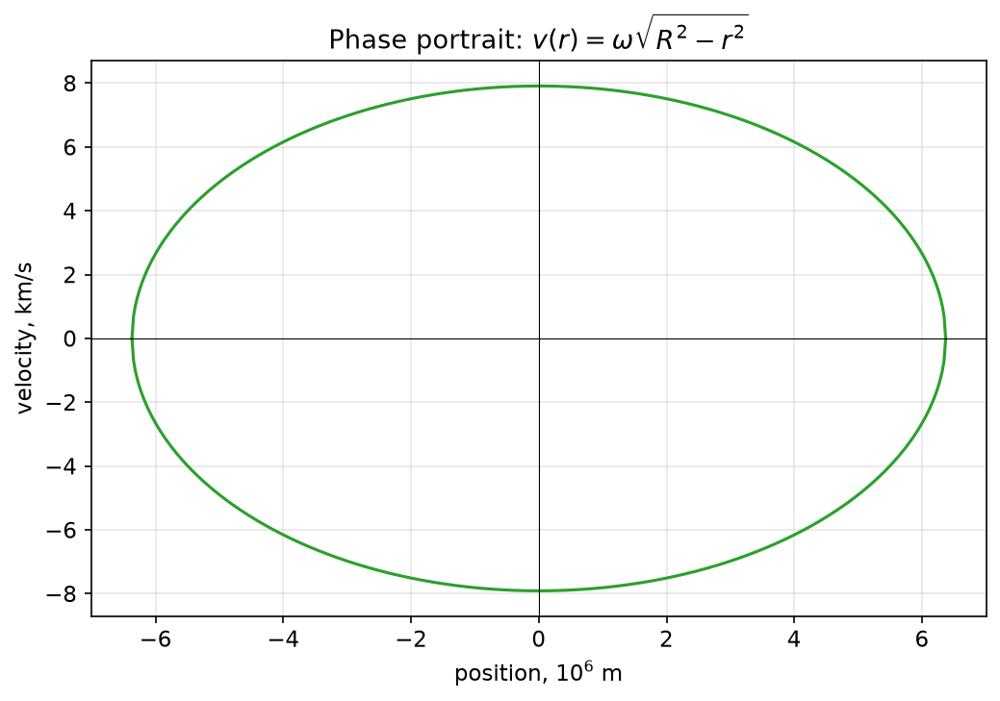
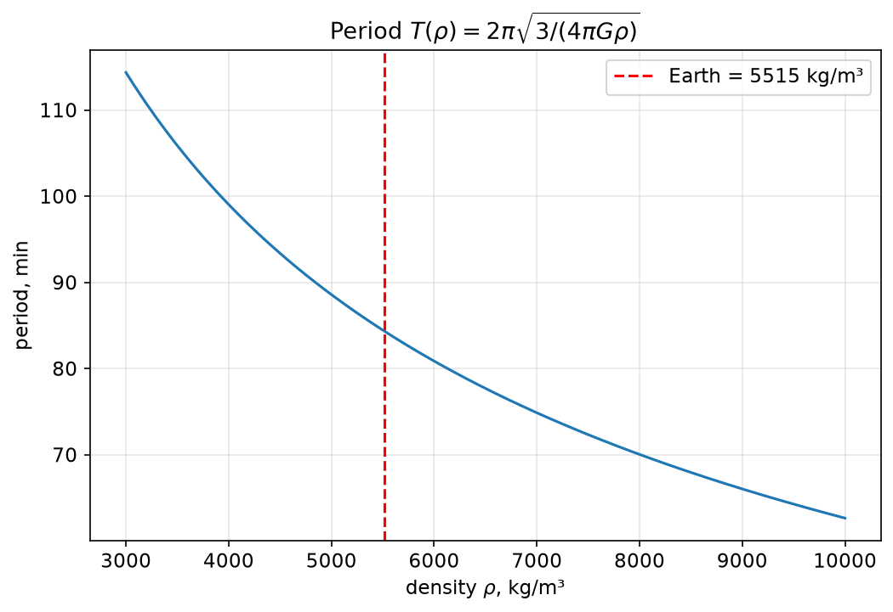
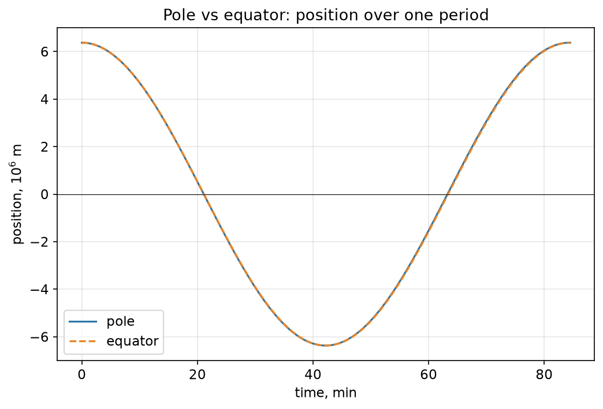
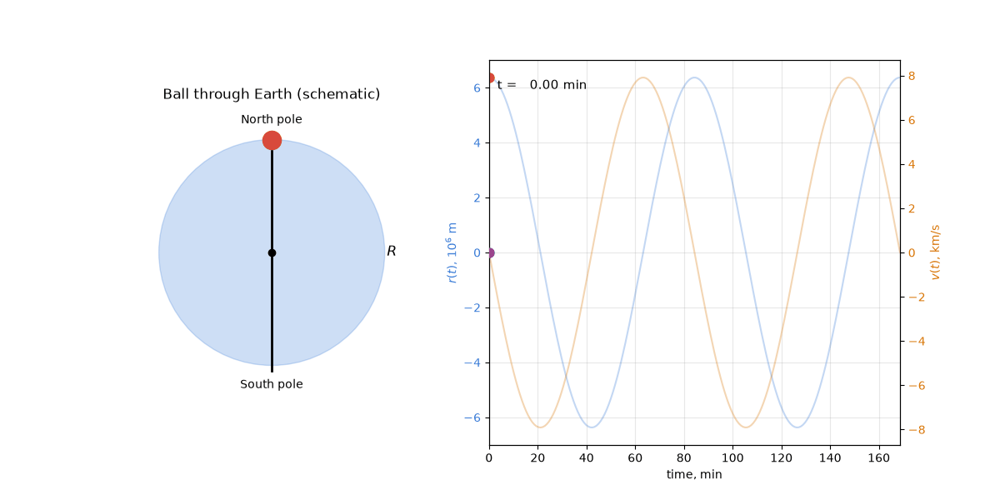

# Pendulum Through Earth: A Gravitational Oscillator

**Author:** Vasili Valentir ([@vaswin555](https://github.com/vaswin555))  
**Date:** 2026  
**License:** CC BY 4.0 (see [LICENSE](LICENSE))  
**Русская версия:** [README.ru.md](README.ru.md)

---

## Abstract

We consider a thought experiment: a tungsten ball is dropped into a narrow
tunnel that passes through the center of the Earth from one pole to the other.
Intuition suggests the ball will fall to the center and stop. Physics says
otherwise: the ball undergoes **harmonic oscillations**, traversing the entire
diameter of the planet in about **84 minutes**, and returning to its starting
point with zero velocity.

This article develops the model in full: from the linear gravity inside a
uniform sphere to the harmonic oscillator equation, numerical estimates,
relativistic and rotational perturbations, comparison with orbital motion,
and analogies with quantum systems.

---

## Table of Contents

1. [Introduction](#1-introduction)
2. [Physics of Gravity Inside Earth](#2-physics-of-gravity-inside-earth)
3. [Mathematics: The Harmonic Oscillator](#3-mathematics-the-harmonic-oscillator)
4. [Numerical Calculations](#4-numerical-calculations)
5. [Perturbations: Rotation, Orbit, Galaxy](#5-perturbations-rotation-orbit-galaxy)
6. [Materials: Why Tungsten?](#6-materials-why-tungsten)
7. [Scale: Distances Traveled](#7-scale-distances-traveled)
8. [Analogies: Atoms, Quantum Oscillators](#8-analogies-atoms-quantum-oscillators)
9. [Philosophy: A Perpetual Motion That Doesn't Violate Physics](#9-philosophy-a-perpetual-motion-that-doesnt-violate-physics)
10. [Conclusion](#10-conclusion)
11. [References](#11-references)

---

## 1. Introduction

### 1.1 The Idea

Imagine a tunnel drilled straight through the Earth, from the North Pole to
the South Pole, passing exactly through the center of the planet. The tunnel
is evacuated, and its walls are perfectly smooth. A small tungsten ball is
placed at one end and released from rest.

What happens?

The naive answer — "the ball falls to the center and stops" — is wrong.
The correct answer is that the ball performs **periodic oscillations**:
it accelerates toward the center, passes through it at maximum speed,
decelerates on the way out, stops momentarily at the opposite end,
and then falls back. This motion repeats indefinitely.

This is a **gravitational pendulum** — a harmonic oscillator whose period
depends only on the density of the Earth.

### 1.2 Why This Matters

The "tunnel through Earth" problem is a classic in theoretical physics.
It is simple enough to solve exactly, yet rich enough to illustrate:

- the **linearity of gravity** inside a uniform sphere;
- the **harmonic oscillator** equation in a gravitational context;
- the **equivalence** between oscillation through the center and orbital
  motion near the surface (both have the same period);
- **perturbations** from the Earth's rotation (Coriolis effect) and
  orbital motion.

It also serves as an excellent pedagogical example, connecting classical
mechanics, gravitation, and even quantum mechanics.

### 1.3 Structure of the Article

We proceed in ten steps:

1. Derive the force of gravity inside a uniform sphere (Section 2).
2. Solve the resulting differential equation (Section 3).
3. Compute numerical values for the period and maximum speed (Section 4).
4. Discuss perturbations: Earth's rotation, orbital motion, galaxy (Section 5).
5. Justify the choice of tungsten as the ball material (Section 6).
6. Compute the distances traveled per cycle, per day, and per year (Section 7).
7. Draw analogies with atoms and quantum oscillators (Section 8).
8. Reflect on the philosophical status of the "perpetual motion" (Section 9).
9. Summarize (Section 10).
10. Cite references (Section 11).

### 1.4 Assumptions

Unless stated otherwise, we assume:

- The Earth is a **uniform sphere** of density $\rho$.
- The tunnel is **evacuated** (no air resistance).
- The ball does not touch the walls.
- Relativistic effects are negligible (we verify this in Section 5).
- The ball is made of tungsten with density $\rho_W = 19{,}250\ \mathrm{kg/m^3}$
  and diameter $1\ \mathrm{m}$.

We will relax these assumptions one by one in Section 5.

---

## 2. Physics of Gravity Inside Earth

### 2.1 The Shell Theorem

Newton's shell theorem states that, for a spherically symmetric mass
distribution, the gravitational force at a distance $r$ from the center
depends only on the mass **inside** the radius $r$:

$$
F(r) = -\frac{G \, M(r) \, m}{r^2},
$$

where $G$ is the gravitational constant, $m$ is the mass of the test body,
and $M(r)$ is the mass enclosed within radius $r$.

### 2.2 Mass Inside Radius $r$

For a uniform sphere of density $\rho$:

$$
M(r) = \frac{4}{3} \pi r^3 \rho.
$$

### 2.3 The Force Is Linear in $r$

Substituting $M(r)$ into the force law:

$$
F(r) = -\frac{G}{r^2} \cdot \frac{4}{3} \pi r^3 \rho \, m
      = -\frac{4}{3} \pi G \rho \, m \, r.
$$

Introduce the **spring constant**:

$$
k = \frac{4}{3} \pi G \rho \, m.
$$

Then:

$$
\boxed{F(r) = -k \, r}.
$$

This is the **Hooke's law** — the force is proportional to the displacement
from the center, directed inward.

### 2.4 Physical Interpretation

Inside a uniform sphere, gravity behaves like a **spring**. This is a
non-trivial result: outside the sphere, gravity falls as $1/r^2$; inside,
it grows linearly with $r$.

The transition happens at the surface: at $r = R$, both formulas agree.

For the real Earth, density is not uniform (the core is denser than the
mantle), so the linear law is only approximate. We discuss this in
Section 5.

---

## 3. Mathematics: The Harmonic Oscillator

### 3.1 Equation of Motion

Newton's second law:

$$
m \frac{d^2 r}{dt^2} = -k \, r.
$$

Dividing by $m$ and introducing the **angular frequency**

$$
\omega = \sqrt{\frac{k}{m}} = \sqrt{\frac{4}{3} \pi G \rho},
$$

we obtain the standard harmonic oscillator equation:

$$
\boxed{\frac{d^2 r}{dt^2} + \omega^2 r = 0}.
$$

### 3.2 General Solution

The general solution is:

$$
r(t) = A \cos(\omega t) + B \sin(\omega t).
$$

Initial conditions: at $t = 0$, the ball is at rest at $r = R$:

$$
r(0) = R, \qquad \dot{r}(0) = 0.
$$

This gives $A = R$, $B = 0$, so:

$$
\boxed{r(t) = R \cos(\omega t)}.
$$

### 3.3 Velocity

Differentiating:

$$
\boxed{v(t) = -R \omega \sin(\omega t)}.
$$

The speed is maximum when $|\sin(\omega t)| = 1$, i.e., when $r = 0$:

$$
\boxed{v_{\max} = R \omega}.
$$

### 3.4 Period

The period is:

$$
\boxed{T = \frac{2\pi}{\omega} = 2\pi \sqrt{\frac{3}{4 \pi G \rho}}}.
$$

Note that the period is **independent of the radius** $R$ and of the
mass $m$ of the ball. It depends only on the density $\rho$ of the planet.

This is a remarkable fact: a tunnel through Earth and a tunnel through
Mars would give different periods, but the same tunnel on Earth gives
the same period regardless of the ball's size or material.

---

## 4. Numerical Calculations

### 4.1 Constants

| Quantity | Symbol | Value | Unit |
|----------|--------|-------|------|
| Gravitational constant | $G$ | $6.674 \times 10^{-11}$ | m³·kg⁻¹·s⁻² |
| Earth mass | $M$ | $5.972 \times 10^{24}$ | kg |
| Earth mean radius | $R$ | $6.371 \times 10^{6}$ | m |
| Earth mean density | $\rho$ | $5515$ | kg·m⁻³ |

### 4.2 Angular Frequency

$$
\omega = \sqrt{\frac{4}{3} \pi G \rho}
      = \sqrt{\frac{4}{3} \pi \cdot 6.674 \times 10^{-11} \cdot 5515}
      \approx 1.242 \times 10^{-3}\ \mathrm{rad/s}.
$$

### 4.3 Period

$$
T = \frac{2\pi}{\omega}
  \approx \frac{6.283}{1.242 \times 10^{-3}}
  \approx 5058\ \mathrm{s}
  \approx 84.3\ \mathrm{min}.
$$

### 4.4 Maximum Speed

$$
v_{\max} = R \omega
         \approx 6.371 \times 10^{6} \cdot 1.242 \times 10^{-3}
         \approx 7913\ \mathrm{m/s}
         \approx 7.9\ \mathrm{km/s}.
$$

This is the **first cosmic velocity** — the speed required for a circular
orbit just above Earth's surface.

### 4.5 Comparison with a Low-Earth-Orbit Satellite

A satellite in low Earth orbit has an orbital period of about 90 minutes.
Our pendulum period is 84.3 minutes — remarkably close. This is not a
coincidence; both motions are governed by the same central force.
### 4.5 Visualization

*Position $r(t)$ of the ball over one full period (~84.3 min).*

*Velocity $v(t)$ — sinusoidal, maximum at the center.*

*Phase portrait $v(r)$ — a semicircle, characteristic of a harmonic oscillator.*

*Period as a function of density. Earth's mean density is marked in red.*

*Comparison: polar pendulum vs equatorial pendulum. The difference is ~10 s per cycle.*

### 4.5a Animation

*The ball accelerates toward the center, reaches maximum speed (~7.9 km/s),
passes through the center, decelerates, momentarily stops at the opposite
pole, and falls back. The full period is ~84.3 minutes.*

### 4.6 Half-Period (One-Way Trip)

The ball traverses the entire diameter of the Earth in:

$$
\frac{T}{2} \approx 42.15\ \mathrm{min} \approx 2529\ \mathrm{s}.
$$

---

## 5. Perturbations: Rotation, Orbit, Galaxy

So far we have treated the Earth as a uniform, non-rotating sphere in
isolation. Real Earth is none of these. In this section we estimate the
magnitude of each perturbation.

### 5.1 Earth's Rotation (Coriolis Effect)

Earth rotates with angular velocity

$$
\Omega = \frac{2\pi}{T_{\text{sidereal}}}
       = \frac{2\pi}{86{,}164\ \mathrm{s}}
       \approx 7.292 \times 10^{-5}\ \mathrm{rad/s}.
$$

A body moving with velocity $v$ in a rotating frame experiences the
**Coriolis acceleration**

$$
\vec{a}_{\text{Cor}} = -2 \, \vec{\Omega} \times \vec{v}.
$$

Its magnitude for motion along the tunnel is

$$
a_{\text{Cor}} \approx 2 \, \Omega \, v.
$$

At maximum speed $v_{\max} \approx 7913\ \mathrm{m/s}$:

$$
a_{\text{Cor}} \approx 2 \cdot 7.292 \times 10^{-5} \cdot 7913
                  \approx 1.15\ \mathrm{m/s^2}.
$$

For comparison, gravitational acceleration is $g \approx 9.81\ \mathrm{m/s^2}$,
so the Coriolis effect is about **12% of $g$**.

**Consequence:** A ball in an equatorial tunnel would be pushed sideways
and hit the wall within minutes. The ball in a **polar tunnel** experiences
**zero Coriolis force**, because $\vec{\Omega}$ is parallel to $\vec{v}$.

This is why the **pole-to-pole tunnel** is the natural idealization.

### 5.2 Centrifugal Effect at the Equator

On the equator, the centrifugal acceleration is

$$
a_{\text{cf}} = \Omega^2 R_{\text{eq}}
             = (7.292 \times 10^{-5})^2 \cdot 6.378 \times 10^{6}
             \approx 3.39 \times 10^{-2}\ \mathrm{m/s^2}.
$$

This reduces the effective inward pull. The modified frequency is

$$
\omega_{\text{eq}} = \sqrt{\omega^2 - \Omega^2}.
$$

Numerically:

$$
\omega_{\text{eq}} \approx 1.2397 \times 10^{-3}\ \mathrm{rad/s},
$$

compared to $\omega_{\text{pole}} \approx 1.242 \times 10^{-3}\ \mathrm{rad/s}$.
The relative difference is only **0.18%**, giving

- $T_{\text{pole}} \approx 84.30\ \mathrm{min}$,
- $T_{\text{eq}} \approx 84.47\ \mathrm{min}$.

**A difference of about 10 seconds per cycle.**

### 5.3 Earth's Orbit Around the Sun

The Earth orbits the Sun with speed $v_{\text{orb}} \approx 29.8\ \mathrm{km/s}$
at distance $d \approx 1.496 \times 10^{11}\ \mathrm{m}$. The resulting
centripetal acceleration is

$$
a_{\text{orb}} = \frac{v_{\text{orb}}^2}{d}
              \approx 5.9 \times 10^{-3}\ \mathrm{m/s^2},
$$

about **0.06% of $g$**. The tidal acceleration across the Earth's diameter is

$$
\Delta a \approx \frac{2 G M_\odot R}{d^3}
            \approx 5 \times 10^{-7}\ \mathrm{m/s^2},
$$

**negligible.**

### 5.4 Galaxy

Earth orbits the galactic center at $\sim 230\ \mathrm{km/s}$ with a period
of $\sim 225$ million years. The corresponding tidal acceleration is on the
order of $10^{-10}\ \mathrm{m/s^2}$ — **utterly negligible.**

### 5.5 Summary of Perturbations

| Source | Acceleration | Fraction of $g$ |
|--------|--------------|-----------------|
| Coriolis (equator, max) | $1.15\ \mathrm{m/s^2}$ | 12% |
| Centrifugal (equator) | $3.4 \times 10^{-2}$ | 0.35% |
| Orbital | $5.9 \times 10^{-3}$ | 0.06% |
| Tidal (Sun) | $5 \times 10^{-7}$ | $5 \times 10^{-6}$% |
| Galactic | $\sim 10^{-10}$ | $\sim 10^{-9}$% |

**Conclusion:** The Coriolis effect dominates. A polar tunnel avoids it
entirely.

---

## 6. Materials: Why Tungsten?

### 6.1 Requirements

The ball must:

1. Survive the temperature at Earth's center ($\sim 6000\ \mathrm{K}$).
2. Survive the pressure at the core ($\sim 3.6 \times 10^{11}\ \mathrm{Pa}$).
3. Have sufficient density to minimize air resistance (moot in vacuum).
4. Be non-magnetic (or controllably magnetic, for Coriolis compensation).

### 6.2 Candidate Materials

| Material | Density (kg/m³) | Melting point (K) |
|----------|-----------------|-------------------|
| Cast iron | 7,200 | 1,500 |
| Copper | 8,960 | 1,358 |
| Platinum | 21,450 | 2,041 |
| Mercury | 13,534 | 234 |
| **Tungsten** | **19,250** | **3,695** |
| Osmium | 22,590 | 3,303 |

**No known material survives 6000 K.** Tungsten is the best compromise:
highest melting point among metals, high density, machinable.

### 6.3 The Ball

Diameter: $1\ \mathrm{m}$.  
Volume: $V = \frac{4}{3}\pi (0.5)^3 \approx 0.5236\ \mathrm{m^3}$.  
Mass: $m = \rho_W V \approx 19{,}250 \cdot 0.5236 \approx 10{,}083\ \mathrm{kg}$.

**About 10 tonnes.**

### 6.4 Kinetic Energy at the Center

$$
E_k = \frac{1}{2} m v_{\max}^2
    = \frac{1}{2} \cdot 10{,}083 \cdot 7913^2
    \approx 3.14 \times 10^{11}\ \mathrm{J}
    \approx 314\ \mathrm{GJ}.
$$

For comparison, this is about **75 tonnes of TNT equivalent** — the ball
carries the energy of a small tactical nuclear weapon when it passes through
the center.

### 6.5 Idealization

Since no real material can survive the core, the "tunnel through Earth"
is a **thought experiment**. In the mathematical model, the ball is
**perfectly rigid**, **infinitely strong**, and **does not melt**.

---

## 7. Scale: Distances Traveled

### 7.1 Per Cycle

One full cycle (down and up) covers

$$
S_{\text{cycle}} = 4 R = 4 \cdot 6{,}371{,}000 \approx 25{,}484\ \mathrm{km}.
$$

That is **two Earth diameters**.

### 7.2 Per Day

The number of cycles in one sidereal day:

$$
N_{\text{day}} = \frac{T_{\text{sidereal}}}{T} = \frac{86{,}164}{5058} \approx 17.03.
$$

Distance:

$$
S_{\text{day}} \approx 17.03 \cdot 25{,}484 \approx 434{,}000\ \mathrm{km}.
$$

**The ball travels ~1.13 times the Earth–Moon distance in one day.**

### 7.3 Per Year

Cycles per year:

$$
N_{\text{year}} = \frac{31{,}557{,}600}{5058} \approx 6238.
$$

Distance:

$$
S_{\text{year}} \approx 6238 \cdot 25{,}484 \approx 1.59 \times 10^{8}\ \mathrm{km}.
$$

**1.59 × 10⁸ km ≈ 1.06 astronomical units** — slightly more than the
Earth–Sun distance.

**In one year, the pendulum travels the distance from Earth to the Sun.**

### 7.4 Summary

| Period | Cycles | Distance |
|--------|--------|----------|
| 1 cycle | 1 | 25,484 km |
| 1 day | 17.03 | 434,000 km (~1.13 LD) |
| 1 year | 6,238 | 1.59 × 10⁸ km (~1.06 AU) |

Where LD = lunar distance (384,400 km), AU = astronomical unit (149.6 M km).

---

## 8. Analogies: Atoms, Quantum Oscillators

The harmonic oscillator is one of the most universal structures in physics.
It appears in classical mechanics, quantum mechanics, field theory, and
even in cosmology. The pendulum through Earth is a **classical** harmonic
oscillator with an unusually large amplitude and a spectacular time scale
(~84 minutes). Let us compare it with other oscillators.

### 8.1 Classical Harmonic Oscillator

The equation

$$
\frac{d^2 r}{dt^2} + \omega^2 r = 0
$$

is the canonical form of a harmonic oscillator. The same equation describes:

- a mass on a spring;
- a pendulum at small angles;
- an LC circuit;
- a vibrating string (in Fourier modes).

The pendulum through Earth shares the equation, but the "spring" is
**gravity itself**.

### 8.2 Quantum Harmonic Oscillator

In quantum mechanics, the same equation (with $r$ replaced by an operator)
has discrete energy levels:

$$
E_n = \hbar \omega \left( n + \frac{1}{2} \right),
\qquad n = 0, 1, 2, \ldots
$$

The ground state has **zero-point energy** $E_0 = \frac{1}{2}\hbar \omega$ —
a purely quantum effect with no classical analogue.

If our ball were a quantum particle (which it is not — see below), its
energy levels would be spaced by

$$
\Delta E = \hbar \omega \approx 1.055 \times 10^{-34} \cdot 1.242 \times 10^{-3}
         \approx 1.31 \times 10^{-37}\ \mathrm{J}.
$$

This is **absurdly small** compared to the ball's kinetic energy
($\sim 3 \times 10^{11}\ \mathrm{J}$). The quantum nature is completely
hidden.

### 8.3 Hydrogen Atom

In the Bohr model of the hydrogen atom, the electron orbits the nucleus
under the Coulomb force

$$
F = \frac{k_e Z e^2}{r^2},
$$

which is **inverse-square**, not linear. The orbit is a conic section, and
the period follows Kepler's third law:

$$
T^2 \propto a^3.
$$

So the atom is **not** a harmonic oscillator — it is a **Kepler problem**.
The pendulum through Earth is different: its force is **linear in $r$**,
which makes the period **independent of amplitude** and the motion
**sinusoidal** rather than elliptical.

### 8.4 Pendulum vs. Orbit

Both the tunnel pendulum and a low-Earth-orbit satellite are governed by
gravity. Their periods are almost identical:

| System | Period |
|--------|--------|
| Tunnel pendulum | 84.3 min |
| LEO satellite (~280 km altitude) | ~90 min |
| ISS orbit (~400 km) | ~92 min |

This is not a coincidence. Inside the Earth, gravity acts like a spring
with the same effective constant as the gravitational field at the surface.

### 8.5 Foucault Pendulum

The Foucault pendulum demonstrates Earth's rotation by the precession of
its swing plane. Our pendulum, if oriented along the equator, would show
the **Coriolis effect** in an even more dramatic way: the ball would drift
sideways by hundreds of meters within a few cycles.

Along the pole, however, there is **no precession** and **no Coriolis drift**,
making the polar pendulum the cleanest realization.

---

## 9. Philosophy: A Perpetual Motion That Doesn't Violate Physics

### 9.1 The Appeal of Perpetual Motion

Since ancient times, inventors have dreamed of a machine that runs forever
without external energy input. Such a machine would violate the **first
law of thermodynamics** (conservation of energy) or the **second law**
(entropy increase). No such machine has ever been built.

The pendulum through Earth looks like a perpetual motion machine: the ball
oscillates forever, without fuel, without external input. Is this a
violation?

### 9.2 No Violation

The pendulum does **not** create energy. It **converts** potential energy
into kinetic energy and back, in a closed cycle. The total energy

$$
E = \frac{1}{2} m v^2 + \frac{1}{2} k r^2 = \text{const}
$$

is conserved. No energy is created; none is destroyed.

In a **realistic** tunnel, friction against the walls and residual gas
would slowly dissipate the energy, and the ball would eventually settle
at the center. The "perpetual" motion exists only in the **idealized**
model, where friction and damping are exactly zero.

### 9.3 Idealization in Physics

Physics is full of idealizations:

- the **ideal gas** (no interactions between molecules);
- the **frictionless plane**;
- the **point mass**;
- the **perfectly rigid body**;
- the **harmonic oscillator** itself.

The pendulum through Earth is another such idealization. It is not a
machine that "runs forever" — it is a **model** that helps us understand
the structure of gravitational fields and harmonic motion.

### 9.4 The Philosopher's Pendulum

In a sense, the pendulum through Earth is a **philosopher's pendulum**:
it exists in thought, in equations, in graphs — but never in reality.
And yet, it tells us something true about the universe: that the same
mathematics governs a falling apple, an orbiting satellite, and a
vibrating atom.

---

## 10. Conclusion

We have explored a simple but rich thought experiment: a ball oscillating
through a tunnel that passes through the center of the Earth.

**Key results:**

1. Inside a uniform sphere, gravity is **linear in $r$** — a Hooke's law.
2. The motion is a **harmonic oscillator** with angular frequency
   $\omega = \sqrt{\frac{4}{3} \pi G \rho}$.
3. For Earth, the period is **~84.3 minutes** — almost identical to the
   orbital period of a low-Earth-orbit satellite.
4. The maximum speed at the center is **~7.9 km/s** — the first cosmic
   velocity.
5. The only significant perturbation is the **Coriolis effect** (~12% of
   $g$ on the equator), which vanishes for a **polar tunnel**.
6. The ball travels **25,484 km per cycle**, **434,000 km per day**
   (≈ 1.13 lunar distances), and **1.59 × 10⁸ km per year** (≈ 1.06 AU).
7. The pendulum is a **classical analogue** of the quantum harmonic
   oscillator — but with a mass so large that quantum effects are
   invisible.
8. It is a **perpetual motion in thought**, not in reality: it conserves
   energy, does not violate thermodynamics, and requires frictionless
   idealization.

**Open questions:**

- What is the exact period for a **non-uniform** Earth (PREM model)?
- Could a **small-amplitude** version of this experiment be performed in
  a laboratory using a **gravitational analogue**?
- Is there a **relativistic** correction to the period at the level of
  $G M / (R c^2) \sim 7 \times 10^{-10}$?

These remain as exercises for the reader.

---

## 11. References

1. Newton, I. *Philosophiæ Naturalis Principia Mathematica*, 1687.
   (Shell theorem, gravity.)
2. Feynman, R. P., Leighton, R. B., Sands, M. *The Feynman Lectures on
   Physics*, Vol. I, Ch. 7–9. Addison-Wesley, 1963.
   (Gravity inside a sphere, harmonic motion.)
3. Landau, L. D., Lifshitz, E. M. *Mechanics*. Pergamon Press, 1976.
   (Harmonic oscillator, Coriolis force.)
4. Dziewonski, A. M., Anderson, D. L. *Preliminary reference Earth model*.
   Physics of the Earth and Planetary Interiors, 25(4):297–356, 1981.
   (PREM — non-uniform Earth density.)
5. Goldstein, H., Poole, C. P., Safko, J. L. *Classical Mechanics*.
   Addison-Wesley, 3rd edition, 2001.
   (Central forces, Kepler problem.)

---

*© 2026 Vasili Valentir. Licensed under CC BY 4.0.*
